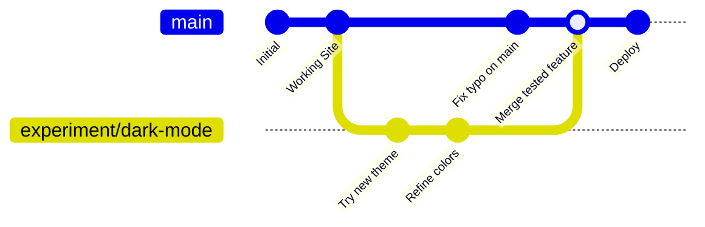

# Git & GitHub Portfolio Guide

A beginner-friendly guide to Git and GitHub, customized for your portfolio project.

---

## A. Commands Executed During This Deployment Task

The commands below were run to audit, stage, commit, and push your portfolio updates to GitHub:

### 1. `git status`
* **What it does:** Shows the state of your working directory and staging area (which files are modified, staged, untracked, or deleted).
* **Why we used it:** To see all pending changes before touching anything, verifying that no secret files or unintended changes were present.
* **What happened:** Displayed your modified redesign components, deleted unreferenced assets, and newly added components.

### 2. `git check-ignore -v .env .env.local`
* **What it does:** Checks whether specific files are matched by rules in `.gitignore` and prints the exact line in `.gitignore` responsible.
* **Why we used it:** To guarantee that private credentials and secret tokens in `.env` or `.env.local` are 100% ignored by Git and will never accidentally leak to GitHub.
* **What happened:** Confirmed `.gitignore` line 25 (`.env`) and line 27 (`.env*.local`) actively protect your secrets.

### 3. `git fetch origin`
* **What it does:** Downloads latest branch references and commits from your GitHub repository (`origin`) without modifying your local working files.
* **Why we used it:** To verify whether any remote commits were pushed from elsewhere before attempting to push.
* **What happened:** Verified that your local branch was directly synchronized with `origin/main` (no merge conflicts).

### 4. `git add -A` (or `git add .`)
* **What it does:** Stages all modified, deleted, and newly created files in the project so they are prepared for the next commit snapshot.
* **Why we used it:** To bundle the complete UI redesign, new navbar, case study updates, and asset cleanups into a single cohesive commit.
* **What happened:** Prepared all intended changes in the Git staging area.

### 5. `git commit -m "feat: complete UI redesign, case study refresh, and asset cleanup"`
* **What it does:** Permanently records a snapshot of all staged changes in your local Git repository with a descriptive message.
* **Why we used it:** To save your milestone cleanly with full traceability.
* **What happened:** Created a new local commit on the `main` branch.

### 6. `git push origin main`
* **What it does:** Uploads your local commits from branch `main` to the remote repository on GitHub (`origin`).
* **Why we used it:** To sync your code with GitHub, which automatically triggers Vercel to build and deploy your live site.
* **What happened:** GitHub accepted the commits, updating `origin/main`.

---

## B. Essential Git Commands Reference

| Command | What It Does | Practical Portfolio Example |
| :--- | :--- | :--- |
| `git status` | Inspects working directory state. | Check if any files were changed while editing a case study. |
| `git add <file>` | Stages a specific file for commit. | `git add src/pages/Home.tsx` |
| `git add .` | Stages all modified and new files in current folder. | Prepare all your recent design tweaks for commit. |
| `git commit -m "msg"` | Saves a snapshot of staged changes with a note. | `git commit -m "update hero typography and spacing"` |
| `git push` | Sends committed changes to GitHub. | Upload your changes so Vercel deploys them. |
| `git pull` | Fetches and merges updates from GitHub to your machine. | Download changes if you edited a file directly on GitHub. |
| `git fetch` | Downloads remote changes without altering your files. | Check if teammates or other machines pushed code. |
| `git log` | Shows the full history of past commits. | Review previous updates, dates, and authors. |
| `git log --oneline` | Shows a condensed, one-line summary of past commits. | Quick view of recent commit hashes and descriptions. |
| `git diff` | Shows line-by-line differences between files. | See exact CSS or text lines you changed before committing. |
| `git branch` | Lists all local branches in the repository. | Check which branch you are currently working on. |
| `git switch <branch>` | Switches to an existing branch. | `git switch main` |
| `git switch -c <name>` | Creates a new branch and switches to it immediately. | `git switch -c feature/new-project-card` |
| `git merge <branch>` | Combines history from another branch into your active one. | Bring changes from a feature branch into `main`. |
| `git restore <file>` | Discards uncommitted local changes to a file. | `git restore src/App.tsx` (reverts file to last commit). |
| `git revert <hash>` | Safely undoes a previous commit by creating a new inverse commit. | Safely roll back a broken change without rewriting history. |
| `git stash` | Temporarily shelves dirty local changes so you have a clean state. | Stash work in progress to quickly pull or switch branches. |
| `git stash pop` | Restores previously stashed changes. | Resume work where you left off. |
| `git remote -v` | Shows the URLs of connected remote repositories. | Verify your GitHub repository connection. |

---

## C. Your Everyday Workflow

Whenever you make changes to your portfolio and want them live on your website, run this 4-step sequence:

```bash
# Step 1: Check what you modified
git status

# Step 2: Stage your changes
git add .

# Step 3: Commit with a clear, descriptive message
git commit -m "Update Tumbledry case study screenshots"

# Step 4: Push to GitHub (triggers Vercel deploy)
git push
```

### Why this order matters:
1. **`git status`** prevents surprises. You can ensure you didn't accidentally touch files you didn't intend to.
2. **`git add .`** tells Git: *"Include these changes in the next package."*
3. **`git commit`** seals the package with a descriptive label.
4. **`git push`** uploads the package to GitHub. Once received, Vercel starts building your production site automatically.

---

## D. Undoing Mistakes Safely

### 1. How to discard unwanted changes in a file
If you made experimental edits to a file and want to throw them away:
```bash
git restore src/components/HeroSection.tsx
```
*This resets the file to match the last commit.*

### 2. How to unstage a file
If you ran `git add .` but didn't mean to include a particular file:
```bash
git restore --staged filename.ext
```
*This removes the file from staging, keeping your file edits intact on disk.*

### 3. How to undo your latest commit safely
If you just committed, but forgot to include something or made a typo in the message:
```bash
git reset --soft HEAD~1
```
*This undoes the commit, but keeps all your changed code in your staging area so nothing is lost.*

### 4. `git revert` vs `git reset` (Important distinction)
* **`git revert <commit-hash>` (Safe & Recommended for published code):**
  Creates a **new commit** that does the exact opposite of the targeted commit. Your history stays intact, and other people (or Vercel) won't experience conflict.
* **`git reset` (Modifies history):**
  Rewinds history backward. Great for local cleanup before pushing, but dangerous if already pushed to GitHub.

> [!CAUTION]
> **Avoid `git push --force` and `git reset --hard`:**
> `git reset --hard` permanently erases all uncommitted work from disk.
> `git push --force` overwrites history on GitHub, which can erase commits and break deployments. Avoid using them unless explicitly advised.

---

## E. Branching Guide

Branches allow you to work on experimental features or large redesigns without breaking the stable code on `main`.



### 1. Create and switch to a new branch
```bash
git switch -c feature/redesign-shelf
```

### 2. Work normally on your branch
Make your edits, then commit:
```bash
git add .
git commit -m "Add new 3D models to shelf"
```

### 3. Switch back to `main`
```bash
git switch main
```

### 4. Merge your branch into `main`
When your new feature is finished and tested:
```bash
git merge feature/redesign-shelf
```

### 5. Delete the branch after merging
Once merged, you no longer need the feature branch:
```bash
git branch -d feature/redesign-shelf
```

---

## F. GitHub and Vercel Deployment

### How it all connects:
1. **Your Local Computer:** Where you write code, run `npm run dev`, and make Git commits.
2. **GitHub Repository:** The secure cloud backup of your source code (`https://github.com/alwinvarghese07/portfolio_2`).
3. **Vercel:** Connected to your GitHub repository via webhook. Every time you push to the `main` branch, Vercel automatically runs `npm run build` and deploys your changes to `alwinvarghese.com`.

### Why `.env.local` stays OUT of GitHub:
* GitHub repositories (especially public ones) are accessible to others.
* Secret keys—like your **Spotify Client Secret** and **Spotify Refresh Token**—grant access to private APIs.
* If pushed to GitHub, bots can scrape and compromise your keys.
* Your `.gitignore` file guarantees `.env.local` stays strictly on your computer.

### How Spotify integration works in production on Vercel:
Instead of committing `.env.local`, you enter your secrets securely into the **Vercel Project Settings**:

1. Go to your [Vercel Dashboard](https://vercel.com/dashboard).
2. Select your `portfolio_2` project.
3. Navigate to **Settings** → **Environment Variables**.
4. Add the following variables (for **Production**, **Preview**, and **Development**):

| Variable Name | Description | Example / Note |
| :--- | :--- | :--- |
| `SPOTIFY_CLIENT_ID` | Your Spotify App Client ID | From Spotify Developer Dashboard |
| `SPOTIFY_CLIENT_SECRET` | Your Spotify App Client Secret | From Spotify Developer Dashboard |
| `SPOTIFY_REDIRECT_URI` | Production redirect URI | `https://alwinvarghese.com/callback` |
| `SPOTIFY_REFRESH_TOKEN` | Generated refresh token | Your permanent refresh token |

> [!TIP]
> When Vercel executes serverless API routes (`/api/spotify/currently-playing`), it injects these environment variables securely at runtime on the server. Your visitor's browser never sees your `SPOTIFY_CLIENT_SECRET`.
